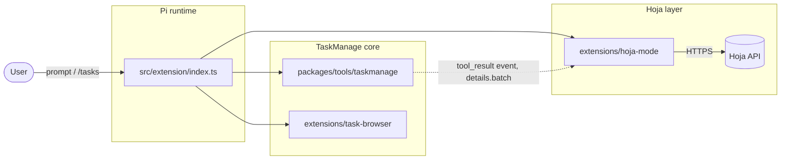

# hoja-manage-pi

Hoja-backed task management for [Pi](https://github.com/hoja-work). One Pi extension that registers:

- **TaskManage** — the task engine (create/update/get/list, acceptance questions with evidence revalidation, hooks that gate tool use on a focused task).
- **Task browser** — read-only TUI overlay opened with `/tasks`.
- **Hoja filing** — coarse tasks publish automatically to a [Hoja](https://hoja.app) issue; steps stay local. Read-only `hoja_list` / `hoja_get` answer "what should I do next".
- **Program status** — reports idle/working/blocked/done/error over OSC 7501 so a Hoja runner can drive a plain `pi -ne -e src/extension/index.ts`. Set `PI_PROGRAM_STATUS=1` to force it on (`0` off); it stays silent when the host Pi already reports natively or Trebol is loaded.
- **Hoja decisions** — `hoja_decision_ask` asks a person a decision on a Hoja task and continues this same Pi session with the answer, exactly once (see below).
- **Hoja artifacts** — `hoja_artifact_upload {paths, issue?, titles?, ttlDays?}` uploads local files (screenshots, recordings, PDFs, rendered options) to Hoja and returns shareable `url`/`absoluteUrl`/`markdown`, so nothing in Hoja points at a path on this box. SVG/HTML are refused by Hoja: render them to PNG first.

## Provenance

Extracted from `cloverinternational/trebol` at commit `e09781a` with `git filter-repo`, so per-file history is preserved (148 commits). No source file was rewritten except the new composition entry.

| Path here | Upstream |
| --- | --- |
| `packages/tools/taskmanage/src` | `packages/tools/taskmanage/src` |
| `packages/tools/taskmanage/test` | `packages/tools/taskmanage/test` (13 suites, unchanged) |
| `packages/tools/mcp` | `packages/tools/mcp` |
| `packages/runtime/core` | `packages/runtime/core` |
| `extensions/taskmanage` | `extensions/taskmanage` (Pi wrapper) |
| `extensions/task-browser` | `extensions/task-browser` |
| `extensions/hoja-mode` | `extensions/hoja-mode` (Hoja filing; synced to `4f7490e`) |
| `.pi/test/tools/hoja-*.test.ts` | `.pi/test/tools/hoja-*.test.ts` (6 suites) |
| `.pi/lib/**` | runtime, policy, ui, tools and claw helpers the above import |
| `src/extension/index.ts` | **new** — single entry composing the extensions |
| `extensions/hoja-decision` | **new here** (HOJA-799-A-8), not in Trebol; Trebol syncs never touch it |
| `extensions/program-status` | adapted from `extensions/swarm-program-status` at `bb517af` (HOJA-802); not a verbatim sync |
| `.pi/lib/runtime/program-status.ts` | `.pi/lib/runtime/program-status.ts` at `bb517af` (unchanged) |

Files keep their upstream paths (rather than being relocated under `src/`) so that `git log` on any file is the real history and upstream diffs apply cleanly.

## Architecture



The Hoja layer does not import TaskManage internals; it observes `tool_result` events whose `toolName` is `TaskManage` and reads the structured `details.batch` envelope. That is why the core works with no Hoja project configured, and `/hoja off` disables filing without touching the task engine.

## Install

```bash
pi extension add /path/to/hoja-manage-pi
```

Then in a session: `TaskManage` is available, `/tasks` opens the browser, `/hoja` toggles publication.

## Build and test

```bash
npm install
npm run build   # tsc, packages/**/src -> dist
npm test        # vitest
```

`extensions/**` are not type-checked here: Pi loads them at runtime, exactly as Trebol does. `tsc` covers `packages/**/src`, matching upstream's build scope.

### Known pre-existing failure

`packages/tools/mcp/test/index.test.ts > turns a closed server pipe into a transport failure` times out under full-suite parallelism and passes in isolation. Trebol's own full suite fails on the same test (verified on `e09781a`), so this is upstream behavior, not a port regression.

## Hoja decisions (wait for an answer)

Up to 20 options. Before creating, existing local image/video/PDF files named in the question, context or options
are uploaded (attached to the task) and the path is replaced by the Hoja URL. A call that still names a local
`.svg`/`.html` file, a `file://` or `localhost` URL, or an absolute `/root`, `/tmp`, `/home` artifact path is refused
with the fix: render to PNG, `hoja_artifact_upload`, pass each URL as an option's `mediaUrl`.

`hoja_decision_ask {task, question, options?[{key,label,description,mediaUrl}], context?, wait_seconds?}` creates a
decision with `taskDecisionCreate` and a `binding` built from the live session, never from the model's arguments:
`harness: "pi"`, Pi's version, `ctx.sessionManager.getSessionId()`, the session file as `transcriptPath`, cwd, git
branch/head, host, pid and project trust as `permissionMode` (`approve`/`no-approve`). The answer then comes back by
the server's hot path (Hoja-Cloud `docs/decisions.md`, "Delivery"), cheapest first:

1. **In the tool call.** With `wait_seconds` (≤600) the call blocks and returns the framed answer as its result.
2. **At settle.** `agent_before_settle` holds up to 120 s (`HOJA_DECISION_HOLD_S`) while a decision is open and
   continues the run with the answer as a user-role custom message. An abort, an error, another continuation or a
   message the person queued ends the hold.
3. **Idle.** In an interactive (TUI/RPC) session a background long-poll delivers with
   `pi.sendUserMessage(text, {deliverAs: "followUp"})`.

One long-poll per decision uses one stable waiter id (`pi:<session>:<decision>`) for `wait` and `take`; a local
phase gate lets exactly one stage call `take`. `delivered` is posted as soon as the text is handed over and `ack`
once the nonce `⟦hoja-decision <id>#` is in the session's entries (next turn start or tool call). Open decisions are
journaled in the session, so `pi --session <file>` after a crash re-arms them; if the nonce already reached the
transcript it acks instead of delivering again. A print (`-p`) run gets stages 1 and 2 only; after it exits the cold
path (a runner's `pi --session <file> -p`) applies. `HOJA_DECISION_ANSWERERS=agents` lets agent principals answer
(tests); `HOJA_RUNNER_ID` / `HOJA_RUNNER_STATE_DIR` name this machine's enrolled runner for the cold path.

## Configuration

Hoja filing resolves a project in this order: this chat's `hoja_project` selection, then `.pi/config/hoja.json` in the repository (`{"project":"<exact name>"}`).

## License

MIT — see [LICENSE](LICENSE). The extracted code originates from `cloverinternational/trebol`, which ships no license; this repository is released under MIT by its owner.
